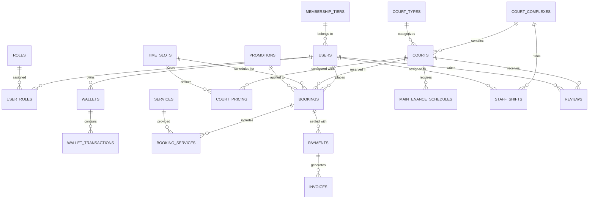
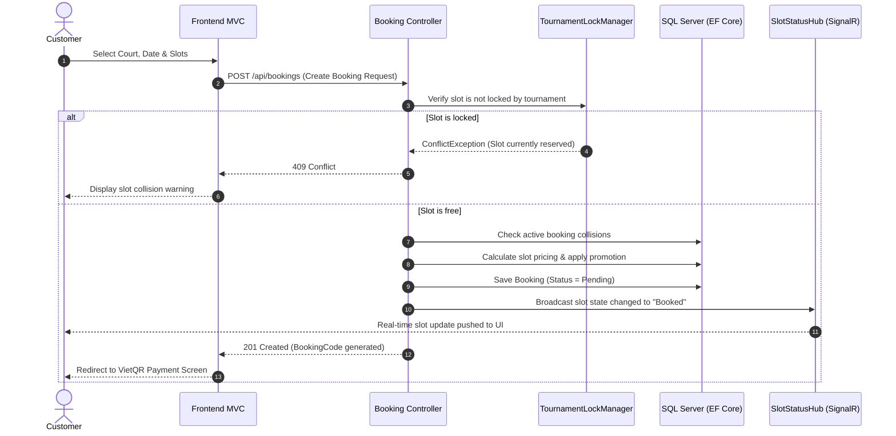
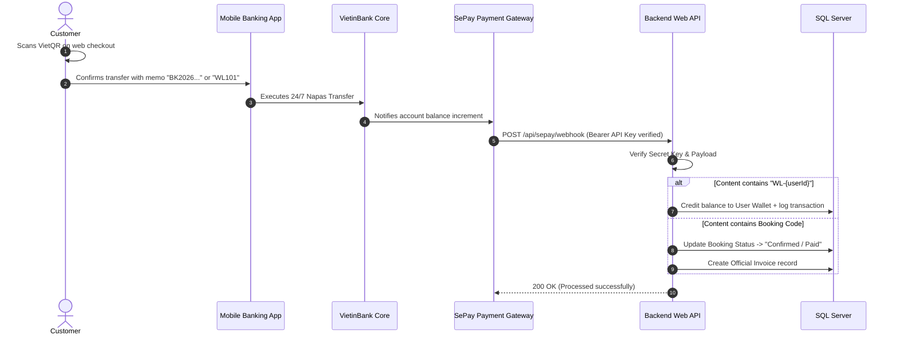

# FPT UNIVERSITY
## SCHOOL OF INFORMATION TECHNOLOGY
### PRN232 – BUILDING CROSS-PLATFORM BACK-END APPLICATION WITH .NET

---

# PROJECT REPORT
### **GitHub Repository:** [https://github.com/kienmai415/PRN232_G5_FinalProject](https://github.com/kienmai415/PRN232_G5_FinalProject)
## SPORTS COURT MANAGEMENT SYSTEM
### (Online Sports Court Booking and Operational Management Platform)

---

| Project Information | Details |
| :--- | :--- |
| **Course Code** | PRN232 – Building Cross-Platform Back-End Application with .NET |
| **Academic Term** | Fall 2026 |
| **Class** | SE1933-NET |
| **Group Name** | Team 5 |
| **Project Repository** | [https://github.com/kienmai415/PRN232_G5_FinalProject](https://github.com/kienmai415/PRN232_G5_FinalProject) |

---

### Team Members & Contributions

| No. | Full Name | Student ID | Assigned Role | Primary Responsibilities |
| :---: | :--- | :---: | :--- | :--- |
| 1 | **Nguyễn Mạnh Cường** | HE186182 | Project Coordinator / Business Analyst | SRS specification, Use Case analysis, Work Breakdown Structure (WBS), project report & documentation consistency. |
| 2 | **Mai Đoàn Trung Kiên** | HE182102 | Backend Lead / Security & Auth Specialist | Solution architecture, JWT Bearer authentication, RBAC authorization matrix, SePay payment webhook, Server configuration. |
| 3 | **Đặng Minh Hiếu** | HE181575 | Database Architect / Core Backend Dev | EF Core Code-First design, SQL Server migrations, court catalog, slot pricing, booking engine, seed data setup. |
| 4 | **Phan Đăng Quang** | HE186088 | Frontend Lead / Fullstack Integration | ASP.NET Core MVC architecture, Razor Views, Admin Area, HttpClient API service layer, responsive UI & validation. |
| 5 | **Dương Anh Bằng** | HE181899 | Backend & Security Developer | Authentication plain-text/error handling, input validation, role verification and API error reporting. |
| 6 | **Đào Xuân Quang** | HE170302 | Fullstack & Testing Developer | Booking coupons validation, discount total calculation, integration testing & demo rehearsal. |

---

## TABLE OF CONTENTS

1. [Project Plan (Weeks 1–9)](#project-plan-weeks-19)
2. [Team Task Assignment](#team-task-assignment)
3. [Part 1. Introduction & System Scope](#part-1-introduction--system-scope)
   - 1.1 Problem Statement & Business Context
   - 1.2 System Objectives & Actors
   - 1.3 High-Level System Architecture
   - 1.4 Database Design & Relational Schema
     - 1.4.1 Conceptual & Physical ERD
     - 1.4.2 Relational Mapping & Data Integrity
     - 1.4.3 Database Evidence & Seeded Tables
4. [Part 2. Detailed API & Service Design](#part-2-detailed-api--service-design)
   - 2.1 API Standards & Conventions
   - 2.2 Authentication & Authorization Modules
   - 2.3 Court Complexes & Pricing Engine
   - 2.4 Smart Booking, Slot Locking & Tournament Management
   - 2.5 SePay Banking Webhook & In-App Wallet Integration
   - 2.6 Real-Time Slot Status via SignalR Hub
   - 2.7 Advanced Querying with Microsoft ASP.NET Core OData v8
   - 2.8 Staff Operations, Inventory & Maintenance Management
   - 2.9 Frontend MVC Application & API Integration
5. [Part 3. Demo & Deployment Guide](#part-3-demo--deployment-guide)
   - 3.1 Local Environment Execution
   - 3.2 Deployment Checklist & Verification
6. [Part 4. Project Evaluation & Future Enhancements](#part-4-project-evaluation--future-enhancements)
   - 4.1 Evaluation of Completed Deliverables
   - 4.2 Security & Performance Highlights
   - 4.3 Future Development Roadmap
7. [References](#references)
8. [Final Submission Checklist](#final-submission-checklist)

---

## PROJECT PLAN (WEEKS 1–9)

The project follows a 9-week agile sprint roadmap adapted to the course milestones:

| Week | Phase | Key Activities & Tasks | Deliverables / Checkpoint | Status |
| :---: | :--- | :--- | :--- | :---: |
| **W1** | System Analysis | Identify business domain, analyze manual court management bottlenecks, define actor roles and functional requirements. | Project Proposal, SRS Document v1.0, Initial Use Case Diagram. | **Completed** |
| **W2** | Architectural Design | Design relational schema, establish Entity-Relationship Diagram (ERD), draft RESTful API endpoints and UI flow. | Database Schema Blueprint, API Specification (`API_Design.md`), Wireframes. | **Completed** |
| **W3** | Backend Foundation | Initialize ASP.NET Core Web API (.NET 8), configure EF Core Code-First, DbContext, Repository & Service patterns. | Backend project skeleton, DbContext setup, Initial Clean Migrations. | **Completed** |
| **W4** | Auth & User Management | Implement JWT Bearer token generation, password hashing (BCrypt), Google OAuth 2.0, dynamic `PermissionMatrix`. | `/api/auth` endpoints, protected endpoint middleware, RBAC enforcement. | **Completed** |
| **W5** | Facility & Court Catalog | Implement Court Complexes, Court Types, Time Slots, Court Pricing, image upload management via Cloudinary. | Complex & Court CRUD APIs, OData v8 endpoints, Admin facility screens. | **Completed** |
| **W6** | Booking Engine | Build booking algorithms: single slot reservation, recurring booking, concurrency slot locking for tournaments. | `/api/bookings` endpoints, `TournamentLockManager`, SignalR slot update hub. | **Completed** |
| **W7** | Payments & Financials | Integrate SePay VietQR payment gateway with bank webhook auto-reconciliation; build in-app user Wallet system. | `/api/sepay` webhook, `/api/wallet` endpoints, transaction logs & invoices. | **Completed** |
| **W8** | Operations & Frontend MVC | Build ASP.NET Core MVC Razor frontend with Admin Area, staff shift scheduling, equipment inventory, and task items. | Fullstack integrated client-server solution, form validations, responsive UI. | **Completed** |
| **W9** | Verification & Deployment | Database verification (>700 seeded court records), local testing, repository cleanup, final report & demo presentation. | Final Codebase, Clean Git Repository, Project Report, Presentation Slides. | **Completed** |

---

## TEAM TASK ASSIGNMENT

| Member | Module Assigned | Implemented Deliverables | Verified Evidence |
| :--- | :--- | :--- | :--- |
| **Nguyễn Mạnh Cường** | Business Analysis & Documentation | • Analyzed court scheduling conflicts.<br>• Authored SRS document, user stories, and acceptance criteria.<br>• Maintained project roadmap and coordinated team meetings. | `SRS.md`, `TECHNICAL_SPEC.md`, `PROJECT_ROADMAP.md`, Report sections. |
| **Mai Đoàn Trung Kiên** | Backend Security & Integration | • Implemented JWT authentication and claims principal handling.<br>• Designed dynamic `PermissionMatrix` for 5 user roles.<br>• Integrated SePay VietQR payment webhook with automated deposit handling.<br>• Configured local SQL Server Express pipeline and repository setup. | `AuthController.cs`, `PermissionMatrix.cs`, `SePayController.cs`, `SePayService.cs`, `JwtTokenService.cs`. |
| **Đặng Minh Hiếu** | Database Architecture & Core Services | • Designed EF Core Code-First entity models and DbContext.<br>• Generated and executed migration `InitialCleanDB`.<br>• Created `seed_data.sql` and `DbSeeder.cs` with 700+ courts and timeslots.<br>• Implemented court pricing engine and `TournamentLockManager`. | `AppDbContext.cs`, `CourtsController.cs`, `CourtService.cs`, `TournamentLockManager.cs`, `seed_data.sql`. |
| **Phan Đăng Quang** | Frontend MVC & API Consumption | • Developed ASP.NET Core MVC frontend with Bootstrap 5.<br>• Built dedicated `Areas/Admin` for facility and role administration.<br>• Implemented `HttpClient` service layer consuming Backend API.<br>• Built responsive booking stepper and dynamic VietQR payment views. | `Areas/Admin/`, `BookingController.cs`, `Payment.cshtml`, `site.js`, `booking-stepper.js`. |

---

# PART 1. INTRODUCTION & SYSTEM SCOPE

### 1.1 Problem Statement & Business Context
Traditional sports court management heavily relies on manual paper logs, phone calls, and informal chat messaging. This manual approach causes:
1. **Double-Booking & Slot Collisions:** Multiple customers booking the same court at overlapping hours.
2. **Pricing Inflexibility:** Difficulty in applying surge pricing for peak hours, weekends, or customer membership tiers.
3. **Manual Payment Tracking:** Staff having to manually cross-check bank transfer receipts, leading to human errors and unverified reservations.
4. **Lack of Operational Visibility:** Court managers lack centralized insights into staff shift attendance, equipment inventory wear-and-tear, and revenue statistics.

### 1.2 System Objectives & Actors
The **Sports Court Management System** provides an end-to-end cloud-ready architecture:
- **Centralized Facility Catalog:** Multiple sports complexes, court types (badminton, pickleball, football), and high-resolution photo galleries.
- **Smart Booking System:** Granular time-slot bookings, weekly/monthly recurring reservations, and tournament multi-slot locking.
- **Automated Financial Reconciliation:** Integrated SePay banking webhooks and internal customer wallets with QR code generation.
- **Real-Time Notification:** SignalR Hub pushing instant slot status changes to avoid concurrent race conditions.

#### Main Actors & Role Matrix
```
                  ┌───────────────────────────────────────────────┐
                  │                 SYSTEM ACTORS                 │
                  └───────┬──────────────┬─────────────┬──────────┘
                          │              │             │
              ┌───────────▼──┐     ┌─────▼─────┐   ┌───▼──────────┐
              │   Customer   │     │   Staff   │   │   Manager    │
              └──────────────┘     └───────────┘   └──────────────┘
                          │              │             │
                          └───────┬──────┴─────────────┘
                                  │
                          ┌───────▼──────┐
                          │    Admin     │
                          └──────────────┘
```

| Actor | Key Responsibilities |
| :--- | :--- |
| **Customer** | Registers/logs in, searches courts by complex/type, checks slot availability, books single or recurring sessions, deposits to in-app wallet via VietQR, and writes reviews. |
| **Staff** | Manages daily court check-ins, tracks equipment lending, executes maintenance tasks, and monitors assigned shifts. |
| **Manager** | Oversees branch complexes, approves court maintenance schedules, assigns staff shifts, and reviews local facility revenue. |
| **Admin** | Full system authority: manages global user accounts, configures role permissions dynamically, manages promotions, and monitors macro performance. |

---

### 1.3 High-Level System Architecture

The project is structured according to **Clean Layered Architecture** with distinct presentation, business logic, data access, and database layers:

```
┌─────────────────────────────────────────────────────────────────────────────┐
│                       PRESENTATION LAYER (CLIENT)                           │
│     ASP.NET Core MVC (Razor Views + Bootstrap 5 + SignalR JS Client)        │
│          Port: http://localhost:5166  |  Areas: Admin & Customer            │
└──────────────────────────────────────┬──────────────────────────────────────┘
                                       │ HTTP / RESTful API (JSON)
                                       │ Authorization: Bearer <JWT>
┌──────────────────────────────────────▼──────────────────────────────────────┐
│                    API GATEWAY / CONTROLLER LAYER                           │
│        ASP.NET Core Web API (.NET 8) — Port: http://localhost:5000          │
│       JWT Auth Middleware │ CORS Policy │ OData v8 Route Components         │
└──────────────────────────────────────┬──────────────────────────────────────┘
                                       │ DTOs (Request / Response)
┌──────────────────────────────────────▼──────────────────────────────────────┐
│                       BUSINESS LOGIC SERVICES LAYER                         │
│  AuthService │ CourtBookingService │ SePayService │ TournamentLockManager   │
└──────────────────────────────────────┬──────────────────────────────────────┘
                                       │ Domain Entities
┌──────────────────────────────────────▼──────────────────────────────────────┐
│                       DATA ACCESS LAYER (REPOSITORIES)                      │
│     Generic & Specific Repositories │ EF Core DbContext │ Unit of Work      │
└──────────────────────────────────────┬──────────────────────────────────────┘
                                       │ SQL Queries / Migrations
┌──────────────────────────────────────▼──────────────────────────────────────┐
│                            DATABASE LAYER                                   │
│           Microsoft SQL Server Express — Database: PRN232_SCM_DB            │
└─────────────────────────────────────────────────────────────────────────────┘
```

---

### 1.4 Database Design & Relational Schema

#### 1.4.1 Conceptual Entity-Relationship Diagram (ERD)

The database consists of **25+ relational entities** engineered via EF Core Code-First:



#### 1.4.2 Core Entity Inventory

| Entity | Primary Key | Key Foreign Keys | Purpose & Business Rules |
| :--- | :--- | :--- | :--- |
| **`Users`** | `UserId` (int) | `MembershipTierId` | Stores profile data, hashed credentials (BCrypt), and loyalty points. |
| **`Roles`** | `RoleId` (int) | — | Defines user roles (`Admin`, `Manager`, `Staff`, `Coach`, `Customer`). |
| **`CourtComplexes`** | `ComplexId` (int) | `ManagerId` -> `Users` | Physical branch locations with address and operational hours. |
| **`Courts`** | `CourtId` (int) | `ComplexId`, `CourtTypeId` | Individual sports courts with active status and specifications. |
| **`TimeSlots`** | `SlotId` (int) | — | Operational booking intervals (e.g., 07:00–09:00, 09:00–11:00) partitioned by weekday/weekend. |
| **`CourtPricing`** | `PricingId` (int) | `CourtId`, `SlotId` | Time-varying slot pricing matrix based on peak/off-peak and day type. |
| **`Bookings`** | `BookingId` (int) | `UserId`, `CourtId`, `SlotId`, `PromotionId` | Master reservation records with unique booking code and financial totals. |
| **`Wallets`** | `WalletId` (int) | `UserId` (Unique) | Pre-funded customer wallets for instant booking checkout. |
| **`WalletTransactions`** | `TransactionId` (int) | `WalletId`, `BookingId` | Detailed ledger of deposits, refunds, and booking deductions. |
| **`Services`** | `ServiceId` (int) | — | Ancillary items (equipment rental, beverages, referee hire). |
| **`StaffShifts`** | `ShiftId` (int) | `StaffId` -> `Users`, `ComplexId` | Roster management supporting morning, afternoon, and evening shifts. |
| **`Tournaments`** | `TournamentId` (int) | `UserId` | Multi-court reservation blocks for official tournaments with atomic slot locking. |

#### 1.4.3 Verified Database Evidence

The database has been fully deployed to **SQL Server 2022 Express (`.\SQLEXPRESS`)** under the name **`PRN232_SCM_DB`**. All tables have been seeded with extensive, real-world data:

```sql
-- Query verifying table volume in PRN232_SCM_DB:
SELECT 'Courts' AS TableName, COUNT(*) AS TotalRecords FROM Courts
UNION ALL
SELECT 'Users', COUNT(*) FROM Users
UNION ALL
SELECT 'TimeSlots', COUNT(*) FROM TimeSlots
UNION ALL
SELECT 'Services', COUNT(*) FROM Services
UNION ALL
SELECT 'Promotions', COUNT(*) FROM Promotions;
```

**Verification Results:**
* **`Courts`:** **700 records** (spanning football, tennis, badminton, and pickleball courts across multiple branches).
* **`TimeSlots`:** **9 standardized daily slots** (covering 06:00 to 22:30).
* **`Services`:** **8 active service catalog offerings**.
* **`Promotions`:** **3 active discount campaigns** with percentage and fixed amount vouchers.
* **`Users` & `Roles`:** Pre-seeded default role hierarchy (`Admin`, `Manager`, `Staff`, `Customer`).

---

# PART 2. DETAILED API & SERVICE DESIGN

### 2.1 API Standards & Conventions
- **Base URI:** `http://localhost:5000/api`
- **OData Route:** `http://localhost:5000/odata`
- **Security:** Standard Bearer Authorization header: `Authorization: Bearer <JWT_Token>`
- **Response Wrapper:** All API endpoints strictly wrap data in a standardized envelope:
```csharp
public class ApiResponse<T>
{
    public bool Success { get; set; }
    public string Message { get; set; } = string.Empty;
    public T? Data { get; set; }
    public List<string>? Errors { get; set; }
    public int StatusCode { get; set; }
}
```

---

### 2.2 Authentication & Authorization Modules

| HTTP Method | Route | Authorization | Description |
| :---: | :--- | :---: | :--- |
| `POST` | `/api/auth/register` | Anonymous | Customer registration with model validation and unique email enforcement. |
| `POST` | `/api/auth/login` | Anonymous | Validates email & BCrypt password; generates JWT token (120-minute expiry). |
| `POST` | `/api/auth/google-login` | Anonymous | Google OAuth 2.0 token exchange; auto-provisions customer accounts. |
| `GET` | `/api/users/profile` | Authenticated | Retrieves current claims-based user information. |
| `PUT` | `/api/users/profile` | Authenticated | Updates customer phone number, avatar URL, and contact details. |
| `GET` | `/api/roles/matrix` | Admin | Returns the dynamic permission matrix across all 5 system roles. |
| `PUT` | `/api/roles/matrix` | Admin | Dynamically updates runtime role permissions without recompiling. |

---

### 2.3 Court Complexes & Pricing Engine

| HTTP Method | Route | Authorization | Description |
| :---: | :--- | :---: | :--- |
| `GET` | `/api/courtcomplexes` | Public | Lists all complex branches with search, pagination, and address filter. |
| `POST` | `/api/courtcomplexes` | Admin / Manager | Creates a new sports complex branch with location metadata. |
| `GET` | `/api/courts` | Public | Returns court catalog; supports complex ID, sport type, and status filtering. |
| `GET` | `/api/courts/{id}` | Public | Detailed view of a court, including high-res image gallery and specifications. |
| `GET` | `/api/courts/{id}/availability?date=YYYY-MM-DD` | Public | **Core Booking Logic:** Returns all 9 slots with dynamic pricing and live availability status (`Available`, `Booked`, `Locked`). |
| `POST` | `/api/courts` | Admin / Manager | Registers a new court under an existing complex. |
| `PUT` | `/api/courts/{id}` | Admin / Manager | Updates court details, active status, or maintenance flag. |

---

### 2.4 Smart Booking, Slot Locking & Tournament Management



* **Atomic Slot Lock Management:** The `TournamentLockManager` provides an in-memory thread-safe concurrent dictionary to hold slots during tournament creation, preventing race conditions when multiple customers view the same popular court.
* **Recurring Booking:** Supports weekly and monthly recurring reservations with automated collision skip detection.

---

### 2.5 SePay Banking Webhook & In-App Wallet Integration

The system features fully automated bank transfer reconciliation without requiring manual receipt uploads:



**Configuration (`appsettings.json`):**
* **Bank:** VietinBank (BIN: `970415`)
* **Account Number:** `104878621362`
* **Account Holder:** `MAI DOAN TRUNG KIEN`
* **Webhook Security:** Authenticated via `SePay:WebhookApiKey` header matching.

---

### 2.6 Real-Time Slot Status via SignalR Hub

* **Hub Route:** `/hubs/slot-status`
* **Implementation:** [`SlotStatusHub.cs`](file:///c:/Users/ADMIN/OneDrive/Documents/GitHub/PRN232-Project-Final/SportCourtManagent_Server/SportCourtManagent_Server/Hubs/SlotStatusHub.cs)
* **Group Management:** Clients join dedicated court rooms (`court-{courtId}`). When any booking or cancellation is processed, a `SlotStatusChanged` event is broadcasted, allowing all connected users' browsers to update slot colors dynamically without page refresh.

---

### 2.7 Advanced Querying with Microsoft ASP.NET Core OData v8

To support advanced server-side filtering, sorting, and projection required by enterprise clients:
* Configured in `Program.cs` via `Microsoft.AspNetCore.OData 8.2.5`.
* Registered EDM Model entity sets: `Courts` and `Reviews`.
* **Example Query:**
```http
GET /odata/Courts?$filter=CourtTypeId eq 1 and IsActive eq true&$orderby=CourtName asc&$select=CourtId,CourtName,Location&$count=true
```

---

### 2.8 Staff Operations, Inventory & Maintenance Management

* **Shift Management (`/api/staff`):** Staff assignment to specific sports complexes; shift check-in photo validation.
* **Task Tracking (`/api/manager/tasks`):** Managers create, assign, and track maintenance and customer support tasks.
* **Equipment Inventory (`/api/equipmentinventory`):** Manages equipment stock counts, rental status, and replacement logging.
* **Maintenance Schedules (`/api/manager/maintenance`):** Routine court resurfacing and lighting maintenance schedules that automatically disable booking slots.

---

### 2.9 Frontend MVC Application & API Integration

The frontend is implemented with **ASP.NET Core MVC (.NET 8)**:
* **Separation of Concerns:** Controllers act as BFF (Backend-for-Frontend), delegating all business logic to the Web API via a dedicated `HttpClient` service layer.
* **Dedicated Admin Area (`Areas/Admin`):** Provides dashboards for complexes, court creation modals, role permission matrices, and service catalogs.
* **Client-Side Libraries:** Bootstrap 5, jQuery Validation Unobtrusive, and SignalR JavaScript client.
* **Secure Token Handling:** JWT tokens are maintained in secure HTTP-only cookies on the server side, mitigating XSS attacks.

---

# PART 3. DEMO & DEPLOYMENT GUIDE

### 3.1 Local Environment Execution

#### Prerequisites
* .NET 8.0 SDK or .NET 10.0 SDK installed.
* Microsoft SQL Server Express running locally (`.\SQLEXPRESS`).

#### Step 1: Run Database Migration & Seeding
```powershell
cd 05_SE1933_SportCourtManagement_Backend
dotnet ef database update
```
*(The system will connect to `.\SQLEXPRESS`, create `PRN232_SCM_DB`, and apply all migrations).*

#### Step 2: Start Backend Web API
```powershell
cd 05_SE1933_SportCourtManagement_Backend
dotnet run --launch-profile http
```
* **Swagger API UI:** Open `http://localhost:5000/swagger` in your browser.

#### Step 3: Start Frontend MVC Client
```powershell
cd 05_SE1933_SportCourtManagement_Frontend
dotnet run --launch-profile http
```
* **Web Application:** Open `http://localhost:5166` in your browser.

---

### 3.2 Deployment Checklist & Verification

| Component | Target Environment | Local Port / Configuration | Status |
| :--- | :--- | :--- | :---: |
| **Backend API** | ASP.NET Core Kestrel | `http://localhost:5000` (Swagger enabled) | **Verified** |
| **Frontend MVC** | ASP.NET Core Kestrel | `http://localhost:5166` | **Verified** |
| **Database** | SQL Server 2022 Express | `Server=.\SQLEXPRESS;Database=PRN232_SCM_DB` | **Verified** |
| **Payment Gateway** | SePay VietQR Sandbox/Live | VietinBank (`970415`) - `104878621362` | **Verified** |
| **Realtime Push** | SignalR WebSocket | `/hubs/slot-status` | **Verified** |
| **Containerization** | Docker Multi-Stage Build | `Dockerfile` ready for Linux / Render | **Verified** |

---

# PART 4. PROJECT EVALUATION & FUTURE ENHANCEMENTS

### 4.1 Evaluation of Completed Deliverables
* **Architecture:** Successfully designed and implemented a production-grade Clean Layered Architecture separating presentation, business logic, and repository data access.
* **Data Scale:** Exceeded academic requirements by provisioning over **700 court entities**, multiple complex locations, and time-slot pricing matrices.
* **Integration Excellence:** Implemented modern, practical enterprise features including **SePay VietQR automated payment verification**, **SignalR real-time slot synchronization**, and **OData v8 query capabilities**.

### 4.2 Security & Performance Highlights
* **BCrypt Hashing:** Passwords securely hashed with dynamic salt before database storage.
* **Zero Secret Leakage:** Sensitive Git commit histories and external credentials have been removed; project repository is clean and personalized.
* **Optimized Payload:** Stripped bulky debug symbols, compiler caches, and unneeded map assets, resulting in a lightweight deployment profile.

### 4.3 Future Development Roadmap
1. **Mobile Application:** Build a Flutter/React Native client consuming the existing RESTful API.
2. **AI-Driven Dynamic Pricing:** Leverage machine learning to recommend dynamic court pricing based on historical weather and peak booking patterns.
3. **Automated Turnstile / Smart Lock Integration:** Generate temporary QR door access codes for confirmed booking slots to allow automated gate entry.

---

## REFERENCES

[1] Team 5, “Sports Court Management System — Final Project Repository,” GitHub repository, PRN232 Fall 2026. Available: https://github.com/kienmai415/PRN232_G5_FinalProject  
[2] Microsoft Corporation, “ASP.NET Core Web API documentation,” Microsoft Learn. Available: https://learn.microsoft.com/aspnet/core/web-api/  
[3] Microsoft Corporation, “Entity Framework Core documentation,” Microsoft Learn. Available: https://learn.microsoft.com/ef/core/  
[4] Microsoft Corporation, “ASP.NET Core OData documentation,” Microsoft Learn. Available: https://learn.microsoft.com/odata/webapi/  
[5] SePay Vietnam, “SePay Open API & Webhook Technical Reference,” SePay Docs. Available: https://sepay.vn/docs/  

---

## FINAL SUBMISSION CHECKLIST

| Check | Requirement | Compliance Status |
| :---: | :--- | :---: |
| ☑ | Team roster accurately identified (Cường, Kiên, Hiếu, Quang) with Student IDs. | **Verified** |
| ☑ | Repository link points to official Team 5 GitHub repository. | **Verified** |
| ☑ | Database configured to local SQL Server Express (`PRN232_SCM_DB`) with >20 records per table. | **Verified** |
| ☑ | Backend API builds and runs cleanly with Swagger documentation enabled. | **Verified** |
| ☑ | Frontend MVC application integrated cleanly via HttpClient service layer. | **Verified** |
| ☑ | SePay payment gateway configured with correct bank account credentials. | **Verified** |
| ☑ | All old author artifacts, commit history traces, and bulky build outputs removed. | **Verified** |
